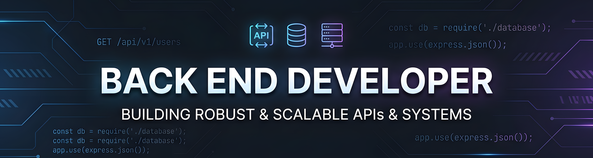

  

  <h1>Muhammad Iqbal</h1>

  <h3>Backend Developer | Node.js | Express.js | REST API | Database Engineering</h3>

  [Portfolio](https://muhiqbal.vercel.app/) · [GitHub](https://github.com/mhmdiqb) · [LinkedIn](https://www.linkedin.com/in/muhammad-iqbal-b7abb2438/) · [Instagram](https://instagram.com/mh_md.iqb)

## About Me

I build backend applications with JavaScript and Node.js, with a focus on REST APIs and database design and management. My projects include web applications built with Express and MySQL.

I work with authentication and authorization as part of backend development, and I am interested in software engineering practices and backend security.

## Tech Stack

**Backend Development:** Node.js, Express.js, REST APIs 
**Programming Languages:** JavaScript 
**Databases:** MySQL 
**ORMs:** Prisma, Sequelize 
**Tools & Testing:** Swagger, Jest, Git, GitHub, Postman

## Featured Projects

### CampusFix

Campus facility reporting app with role-based workflows for students, technicians, and administrators. Its Express API supports reporting and follow-up, with Prisma models and JWT authentication.

**Tech:** Node.js, Express.js, Prisma, MySQL, JWT 
**Repository:** [mhmdiqb/campusFix](https://github.com/mhmdiqb/campusFix)

### Event Ticketing API

REST API for ticket reservations, inventory management, and booking validation. Zod schemas validate input, and Swagger UI documents the API.

**Tech:** Node.js, Express.js, Prisma, MySQL, JWT, Zod, Swagger 
**Repository:** [mhmdiqb/event-ticketing-api](https://github.com/mhmdiqb/event-ticketing-api)

### Bank Sampah Management

Backend API for a waste management system, including user rewards and transaction records. Sequelize manages the MySQL data layer, with Jest tests and Swagger API documentation.

**Tech:** Node.js, Express.js, Sequelize, MySQL, Jest, Swagger 
**Repository:** [mhmdiqb/bank-sampah-management](https://github.com/mhmdiqb/bank-sampah-management)

### Laundry Express

Web-based laundry management system with server-rendered EJS views and session-based user state, backed by MySQL.

**Tech:** Node.js, Express.js, EJS, MySQL, Express Session 
**Repository:** [mhmdiqb/laundry_express](https://github.com/mhmdiqb/laundry_express)

## Pac-Man Contribution Graph

<picture>
  <source media="(prefers-color-scheme: dark)" srcset="https://raw.githubusercontent.com/mhmdiqb/mhmdiqb/pacman-output/pacman-contribution-graph-dark.svg">
  <source media="(prefers-color-scheme: light)" srcset="https://raw.githubusercontent.com/mhmdiqb/mhmdiqb/pacman-output/pacman-contribution-graph.svg">
  
</picture>
