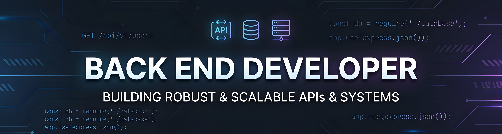

# 💫 About Me

🔭 I'm currently working on building scalable REST APIs and backend applications using Node.js and Express.

👯 I'm looking to collaborate on open-source backend tools, API integrations, and database optimization projects.

🤝 I'm looking to improve my skills in system design, cloud infrastructure, and backend architecture.

🌱 I'm currently learning DevOps fundamentals, Docker, and PostgreSQL performance optimization.

💬 Ask me about JavaScript, Node.js, REST APIs, SQL, database modeling, and backend development.

⚡ Fun fact: I enjoy turning complex business logic into clean, efficient SQL queries and APIs.

---

## 🌐 Socials

---

## 💻 Tech Stack

---

## 📊 GitHub Statistics

  
  

---

## 🔥 GitHub Streak

  

---

## 🏆 Top Contributed Repositories

  

---

## 👀 Profile Visitors

  

---

## 👾 Contribution Graph

  <picture>
    <source
      media="(prefers-color-scheme: dark)"
      srcset="https://raw.githubusercontent.com/mhmdiqb/mhmdiqb/pacman-output/pacman-contribution-graph-dark.svg?game=pacman"
    />
    <source
      media="(prefers-color-scheme: light)"
      srcset="https://raw.githubusercontent.com/mhmdiqb/mhmdiqb/pacman-output/pacman-contribution-graph.svg?game=pacman"
    />
    
  </picture>

---

<!-- Profile README: Muhammad Iqbal | Backend Developer -->
