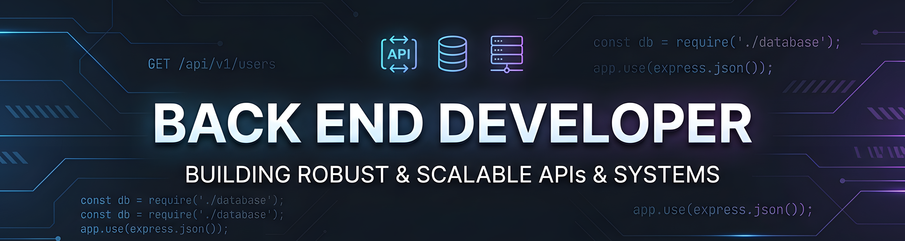

  

# Hi 👋, I'm Muhammad Iqbal

### Backend Engineer • Database Specialist • System Architecture Enthusiast

Building robust, scalable APIs and reliable backend infrastructure to power modern applications.

 

---

# 🚀 About Me

Backend Engineering enthusiast focused on designing efficient databases, building high-performance REST APIs, and structuring clean backend architecture.

I enjoy converting complex business logic into clean code, optimized SQL queries, and scalable service integration.

### What I Do

* ⚡ Design & build scalable REST APIs & Backend Services
* 🗄️ Structure relational databases, write triggers, & optimize SQL queries
* 🛠️ Architect modular software solutions and microservices
* 🔄 Develop automation scripts and continuous integration workflows
* 🚀 Continuously explore System Design, Cloud Infrastructure, & DevOps

---

# 🎯 Current Focus

## ⚡ Backend Development & Architecture

Building robust backend services with:

* Node.js & Express.js
* JavaScript / TypeScript
* PHP & Go
* RESTful API Design
* Modular & Layered Architecture

### Focus Areas

* High-Performance REST APIs
* Authentication & Authorization Systems
* E-Commerce & Management System Backend
* API Gateway & Middleware Development

---

## 🗄️ Database Engineering

Structuring data integrity and optimizing execution pipelines.

### Areas Explored

* Relational Database Modeling (ERD & Normalization)
* Automated Triggers & Stored Procedures
* Query Optimization & Indexing Strategies
* Multi-tenant Database Architectures

### Databases & Tools

* MySQL & MariaDB
* PostgreSQL
* MongoDB
* XAMPP & DB tools

---

## 🛠️ DevOps & Infrastructure

Streamlining deployment and system operations.

### Focus & Experiments

* Docker Containerization
* GitHub Actions Automation
* Linux Server Management & Shell Scripting
* Cloud & Web Hosting Operations

---

# 💻 Technology Stack

## ⚡ Backend & Languages

---

## 🗄️ Databases

---

## 🛠️ Tools & DevOps

---

# 🌟 Featured Projects

| Project | Description | Tech Stack |
| :--- | :--- | :--- |
| 🧺 **Laundry Management Platform** | Complete backend & database system with custom MySQL triggers for automated transaction locking. | Node.js • Express • MySQL |
| ♻️ **Bank Sampah Platform** | Waste management ecosystem backend supporting user rewards and transaction logs. | Node.js • Express • MySQL |
| 🎟️ **Event Ticketing API** | Scalable REST API for ticket reservation, stock management, and booking validation. | Node.js • Express • REST API |
| 🛠️ **Campus Fix Utility** | Campus maintenance utility application backend for handling support tickets and user roles. | JavaScript • MySQL • Node.js |

---

# 💼 Experience Highlights

## 💻 Freelance Web & Backend Developer

Building custom landing pages, administrative dashboards, and backend services for local businesses (UMKM).

### Key Contributions

* Database schema design and normalization
* Custom RESTful API development and client integration
* Business logic implementation and database automation
* Server deployment and domain hosting management

---

## 🛠️ Systems & Database Projects

Developing modular application systems with clean architecture and maintainable codebase patterns.

### Key Contributions

* Implementation of database triggers for strict transactional security
* High-availability database modeling for campus and commercial tools
* GitHub Actions integration for automated profile workflows

---

# 🔥 GitHub Streak

---

# 📈 Contribution Graph

<picture>
  <source media="(prefers-color-scheme: dark)" srcset="https://raw.githubusercontent.com/mhmdiqb/mhmdiqb/pacman-output/pacman-contribution-graph-dark.svg?game=pacman" />
  <source media="(prefers-color-scheme: light)" srcset="https://raw.githubusercontent.com/mhmdiqb/mhmdiqb/pacman-output/pacman-contribution-graph.svg?game=pacman" />
  
</picture>

---

# 💭 Philosophy

> Clean architecture and well-designed databases are the invisible foundation of every great digital product.

---

### Thanks for visiting my profile 🚀

Always open to collaboration, API integration projects, and technology discussions.

